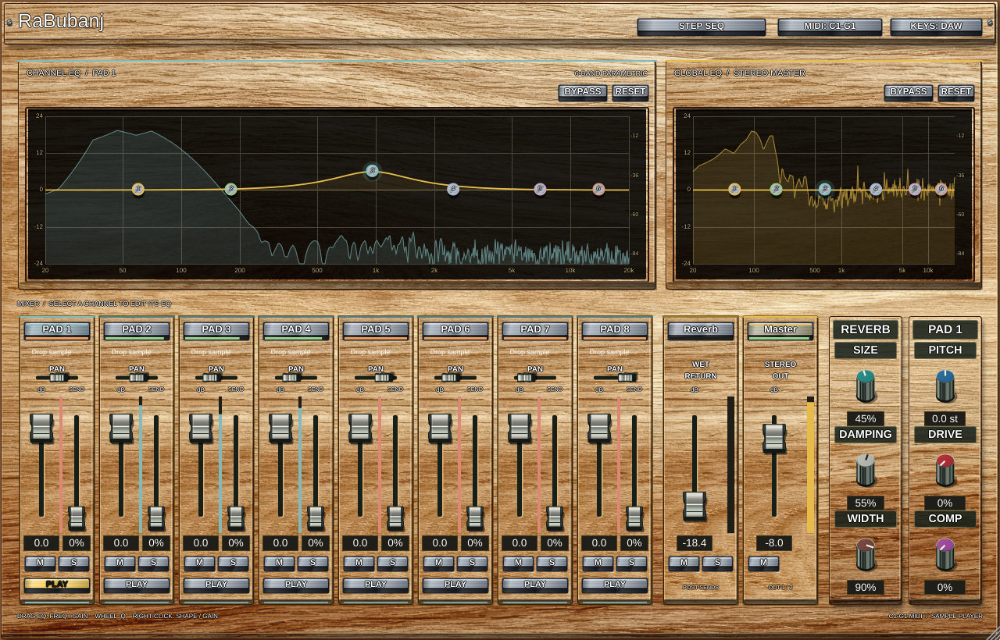
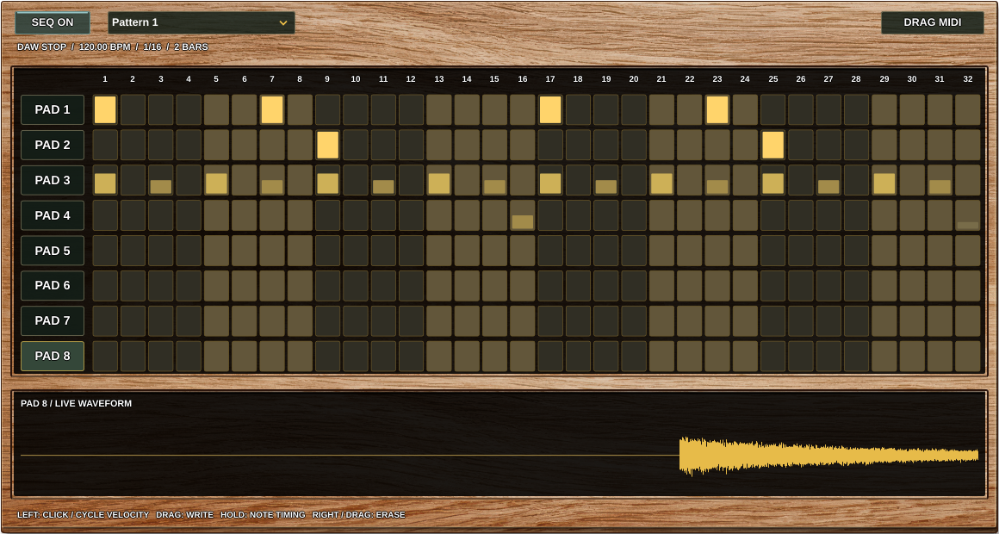

# RaBubanj 0.16.1

Windows x64 VST3 and standalone drum sample instrument by Voyagersquare, with raised wood panels and metal controls, per-channel processing and a shared stereo Reverb. Windows installer with selectable VST3/Standalone components, plus a portable ZIP.

[**Download Windows installer — VST3 + Standalone**](https://github.com/voyagersquare/RaBubanj/actions/runs/44883314452/artifacts/14699097022) · [Portable ZIP](https://github.com/voyagersquare/RaBubanj/actions/runs/44883314452/artifacts/14699106880) · [Validated Windows build](https://github.com/voyagersquare/RaBubanj/actions/runs/44883314452).

Extract the installer ZIP and run **RaBubanj-0.16.1-Setup-x64.exe**. Choose VST3, Standalone or both.

[Installer instructions in Croatian](docs/INSTALLER-HR.md) · [Full Windows instructions](docs/WINDOWS-HR.md) · [Validation](VALIDATION.md)



## Step sequencer

[64-step preview](docs/sequencer-64-steps.png) · [128-step preview, scrolled to the end](docs/sequencer-128-steps.png).

- **STEP SEQ** opens a dedicated sequencer page that replaces the mixer below the shared header. Click **MIXER** or the **red X** to return; mixer controls and EQ panels are hidden while sequencing. It offers **32, 64 or 128 sixteenth-note steps × 8 rows**, selected independently for each pattern with the **STEPS dropdown**. **PAD 1–PAD 8 labels are on the left.** Patterns last **2, 4 or 8 bars in 4/4**, respectively.
- **Scroll longer patterns:** 32 cells remain visible at a readable size. Hover the grid and use the mouse wheel (vertical or horizontal), or drag the horizontal scrollbar, to reach the final step. PAD labels stay fixed on the left; the **VIEW** readout shows the visible range. Shortening a pattern retains inactive tail notes and timing; extending restores them. Inactive steps are excluded from playback and MIDI export.
- **Left-click** an empty cell to write the strongest hit. Repeated clicks on the same cell cycle **127 → 88 → 48 → 32 → 127**. Right-click is the only erase action; cycling never deletes a note.
- **Right-click** erases. Hold and drag the right button to erase several cells, including intervening cells during fast drags. **Hold and drag left** to write strongest notes into empty cells, including intervening cells in fast strokes. Existing notes keep their velocity and timing; revisiting them does not cycle them.
- **Hold a note for 650 ms without moving** to open its **TIMING** slider. Choose **−50% to +50% of a sixteenth-note step**; negative is earlier, positive is later, and 0% is on the grid. The readout also shows milliseconds at the current DAW tempo. Double-click the slider to reset to 0. A long press preserves note velocity; a long press on an empty cell creates a strong note. Click the grid or X to dismiss. A small cyan/orange mark identifies shifted notes.
- Click a **PAD label on the left** to select and audition its current sample once. The selected PAD label is brighter and updates the main channel selection. Clicking grid cells keeps the existing four-strength editing workflow.
- The sequencer page includes a **live selected-pad waveform on a solid dark background** below the grid. It shows approximately one second of stereo peak envelopes after Pitch/Drive/Comp/EQ, before level/pan. Both stereo sides are included, so opposite-phase audio remains visible. Select another PAD label to clear the view and follow that sound; incoming MIDI, pad audition and sequence hits all appear. Imported sample filenames remain on the mixer strips.
- Flat cells alternate four darker steps and four lighter steps for clearer beat divisions.
- The SLABA/SREDNJA/JAKA brush buttons are removed. Cell bar height and brightness show the four strengths.
- The **Pattern 1–Pattern 4 dropdown** chooses one of four independent patterns. Selection changes playback at the next audio block while retaining DAW phase. All four patterns, their per-note timing offsets and the selected pattern are saved in the project.
- **SEQ ON** follows DAW tempo, playback position, Play/Stop and host loops. **Space stays with the DAW transport.** There is no competing local clock.
- Drag **DRAG MIDI** into a DAW MIDI track to export the **selected pattern**, including all four velocities, individual timing shifts and the current chromatic/GM note mapping. Switch **SEQ OFF** when playing the exported clip to avoid doubled hits.



[Per-note timing slider preview](docs/note-timing.png).

New instances have four blank 32-step patterns. Each pattern saves its own length and all 128 columns. Existing projects through 0.15 migrate to 32 steps, preserving their notes and timing. State schema 9 uses a 128-column row stride; schemas 6–8 are read with their original 32-column stride. Loading a 0.7 project moves its old pattern into **Pattern 1**, preserving the actual MIDI velocities 48/88/127; Patterns 2–4 remain blank. Projects from before the sequencer restore all patterns blank. 0.8/0.9 projects retain all four patterns with zero timing offsets. Closing the sequencer window does not erase or disable the pattern.

Timing shifts follow tempo as a percentage of one step. At 120 BPM the range is ±62.5 ms. Early notes at step 1 wrap to the end of the selected pattern; they cannot sound before the DAW starts. Host-loop boundary notes are shifted around the host loop itself, including shorter/non-grid loops. An exported MIDI clip wraps early step-1 notes to its end and keeps its exact 8/16/32-beat length.

The sequencer requires an active DAW audio engine and a monitored instrument track. Standalone supports pad audition/external MIDI but supplies no DAW transport for the sequencer. One-shot and Reverb tails may decay after Stop. MIDI export uses one type-0 track, 960 PPQ, channel 10, a 1/32-note gate and an explicit 8/16/32-beat end marker matching the selected length. Export files remain in the OS temporary `RaBubanj-MIDI` folder for deferred host reading.

## Wood panels and metal controls

- The user's original **7680×4302 JPEG** from `wood texture.rar` is embedded **byte for byte** as `Assets/wood-reference.jpg`. Natural wood grain covers the housing, channel sections, EQ frames, Reverb/FX panels and sequencer enclosure. Rendering uses uniform scaling/cropping, a matte red-brown finish that reduces grain contrast while keeping the warm reddish tone, and separate relief lighting. The source JPEG remains unchanged.
- **Flat caption controls** replace raised metal pushbuttons: STEP SEQ, MIDI/keyboard modes, EQ BYPASS/RESET, channel names, M/S and PLAY. The sequencer uses the same flat treatment for SEQ ON/OFF, DRAG MIDI, pattern selection, PAD labels and close controls. They look like the dark REVERB/PAD legend plates and retain their click actions, meters, state feedback and keyboard focus behaviour.
- Rotary knobs retain the supplied-reference silhouette: tall fluted metal cylinders, black bases, coloured matte top discs and thick position bars. They are **15% larger than 0.12** (80.5% of the original reference-model artwork size). Colours remain SIZE teal, DAMPING off-white, WIDTH burgundy, PITCH blue, DRIVE red and COMP purple.
- Faders keep the contoured saddle profile, dark end cheeks, brushed aluminium centre and white index. PAN/TIMING use the matching horizontal profile.
- **Sequencer cells are flat again**, with **four dark steps followed by four light steps**, starting dark at step 1. Eight-step separators and bar/range headings clarify the layout, with stronger dividers every 16 steps. Four velocity bar heights/colours, the playhead and per-note timing markers retain their meanings.
- Larger white bold command labels stay on dark contrast plates. PLAY still lights yellow; close controls stay red. Wood texture, raised panel frames and original sample/sequence workflows remain.
- **Larger black lettering on wood:** channel/master EQ headings, the six-band caption, mixer instructions, sample-source rows, PAN/dB/SEND, WET RETURN/STEREO OUT and strip routing captions. Sequencer titles, tempo/status, timing popup captions and editing help use larger black wood lettering too. White lettering remains on dark controls and graph readouts. Waveform, grid and EQ screen interiors are solid dark for clear data contrast. The crossed-out bottom-right `C1-G1 MIDI / SAMPLE PLAYER` footer tag is removed.
- **RaBubanj wordmark:** dark red calligraphic lettering inspired by the supplied script example. The bundled **Great Vibes** font is under SIL OFL 1.1; the logo is rendered as cached glyph outlines and needs no system font installation.
- [Material and original-asset details](docs/WOOD-UI.md).
- **Right-click an EQ node** for the dark context menu with **Curve shape** (six types), **Gain (dB)**, **Invert gain** and **Band enabled**. Alt-click toggles a band. Drag, wheel, double-click, bypass and reset retain their actions.
- [EQ context-menu preview](docs/eq-menu.png).

## Controls

- **Channel names show live level meters.** Clicking PAD 1, PAD 2 or another channel selects its EQ and processing controls, without playing a sound. Level meters also remain beside the faders.
- The **PLAY** button at the bottom of each drum strip auditions that channel's current sample once. It lights **yellow** while pressed, with a short visible pulse for quick clicks. Factory menus and arrows have been removed.
- Imported filenames stay below each channel name. Drop a mono/stereo WAV, AIFF, FLAC or Ogg file onto a drum strip to replace just that sound. The **x** button removes the imported source. Samples load in the background and their original bytes are embedded in saved DAW projects.
- Both EQ graphs show a **live spectrum** behind the editable response curve. The channel display follows the selected channel after its EQ, before the fader; the master display measures the final stereo output. The left scale shows EQ gain (±24 dB); the right scale shows spectrum level (−90 to 0 dBFS). Analysis uses both stereo channels, including opposite-phase audio.
- The panel beside Reverb contains **PITCH, DRIVE and COMP for the selected drum**. Each of the eight drums saves independent values and supports automation. Select another drum to edit its settings. These drum controls are disabled when the Reverb return is selected.
- **PITCH:** −24 to +24 semitones, default 0. It changes source playback speed and duration. Existing voices glide smoothly to automated pitch changes; new voices start at the requested pitch.
- **DRIVE:** 0–100% soft saturation with antiderivative antialiasing. Default 0% is neutral.
- **COMP:** 0–100% compression strength. Fixed −18 dBFS threshold, 3:1 ratio, 6 dB soft knee, 10 ms attack, and programme-dependent 150–350 ms opto-style release. Stereo linked, with no automatic makeup gain. This is an opto-inspired response, not a hardware circuit model.
- Double-click the three processing knobs to reset them to neutral. Rotary Reverb controls, pan, faders, mute/solo and graph EQ editing remain.

Each of the eight channels retains one built-in starter voice when no user sample is loaded. Old factory source IDs and source recipes remain only for backwards project compatibility; no factory selection controls or factory preview download are offered by the current interface. Old projects retain their selected source until it is replaced by a dropped sample.

## Mixer and EQ

Every drum has level, pan, mute/solo and a post-fader **SEND**, defaulting to **0%**. The Reverb return has its own EQ, level, mute/solo and rotary Size/Damping/Width controls. Master EQ stays visible on the right. The VST3 exposes one stereo output.

Six parametric bands per EQ offer Bell, Low shelf, High shelf, Low cut, High cut and Notch. Select a graph node, drag it for frequency/gain, use the wheel for Q, double-click to reset gain, right-click for shape/gain commands, or Alt-click to enable/disable. Bypass and Reset affect only the chosen EQ. The analyser is visual only and adds no audio latency. It performs FFTs on the GUI thread; audio writes to bounded lock-free buffers only for the visible channel and master.

```text
Sample → Pitch → Drive → Compressor → channel EQ → level/pan → dry mix ─┐
                                                      └→ Send → Reverb │
                                           → return EQ → return level ├→ master EQ → master → stereo out
                                                                      ┘
```

A drum mute also mutes its send. Reverb tails already generated decay naturally. Reverb Solo auditions the wet return only. The master retains its existing gentle saturation.

## MIDI and keyboard

| Pad | Ableton note | MIDI number | PLUGIN audition key |
| --- | --- | ---: | --- |
| PAD 1 | C1 | 36 | A |
| PAD 2 | C#1 | 37 | W |
| PAD 3 | D1 | 38 | S |
| PAD 4 | D#1 | 39 | E |
| PAD 5 | E1 | 40 | D |
| PAD 6 | F1 | 41 | F |
| PAD 7 | F#1 | 42 | T |
| PAD 8 | G1 | 43 | G |

All MIDI channels are accepted. Octave labels vary by host; note numbers are authoritative. **MIDI: GM** selects the legacy mapping for older clips. For computer keyboard recording, enable the DAW's computer MIDI keyboard, arm/monitor the track, choose the C1 octave and keep **KEYS: DAW**. **KEYS: PLUGIN** auditions locally with the window focused; it does not record MIDI in the host. Key repeat is suppressed; shortcuts, text editing and keys during host recording pass through.

## Samples and recall

Drop a single local audio file or file URI from the DAW browser or Explorer onto a drum strip. Proprietary clips that do not expose an audio file must first be exported/consolidated. Limits: mono/stereo, 8–384 kHz, 30 seconds, 32 MB encoded and decoded audio. Stereo is preserved; pan acts as balance on stereo sources. At −24 semitones a 30-second sample lasts up to 120 seconds.

Failed new loads keep the previous sound. Missing/corrupt restored audio stays silent with an error until replaced or cleared. Hover the source row for details; **x** also cancels a pending load. Wait for the filename after opening a project. Embedded audio increases project size, but project recall does not require the original file path. Changing source retains already-playing tails.

Existing parameter IDs and plugin identity are retained. Older projects receive neutral Pitch/Drive/Comp, preserve their mixer/EQs/imported audio, and keep the 0.4 chromatic MIDI and send migration rules. Prior validation and factory catalogues remain archived in `docs`.

## Build on Windows

Use Visual Studio 2022 with **Desktop development with C++**, Windows SDK, CMake 3.22+ and Git. Internet access is needed for the first JUCE fetch; its revision is pinned in CMake.

```powershell
cmake -S . -B build -A x64 -DCMAKE_MSVC_RUNTIME_LIBRARY=MultiThreaded
cmake --build build --config Release --parallel 2
ctest --test-dir build -C Release --output-on-failure
```

Outputs:

```text
build/RaBubanj_artefacts/Release/VST3/RaBubanj.vst3/
build/RaBubanj_artefacts/Release/Standalone/RaBubanj.exe
```

GitHub Actions builds both targets, runs the DSP tests, and validates the VST3 with pluginval at strictness 5 before uploading the portable package. Binaries are unsigned. See [Croatian Windows instructions](docs/WINDOWS-HR.md) and [development roadmap](docs/ROADMAP.md).

## Tests

A full build runs nine suites: drum engine/pitch, parametric EQ, legacy source regression, processor MIDI/state, mixer/editor, sample import/recall, channel colour/spectrum, sequencer timing and sequencer/MIDI/editor integration. The colour/spectrum suite checks neutral bypass, compressor calibration and stereo linking, saturation harmonics, exact pitch-rate conversion, FFT frequency/dBFS calibration, anti-phase stereo, decay, concurrent buffers, real processor taps and state recall. UI tests cover name meters without triggering, yellow PLAY buttons, curve/gain menu actions and cancellation, per-channel knob binding and minimum/default/maximum bounds.

`mixer_tests <absolute-directory>` exports actual JUCE editor snapshots. `sequencer_integration_tests <absolute-directory>` exports sequencer and window previews using a demonstration pattern and simulated host transport. Sequencer coverage includes fractional-BPM/block-boundary accuracy, loops inside a block, start/stop, seeks, pre-roll, same-offset panic, MIDI file parsing, click velocity cycling, left-drag painting, stationary long-press timing, early/late audio offsets and MIDI export, right-drag erasing, four-pattern recall/migration, dedicated-page layout, mixer visibility restoration, MIXER/X navigation, 32/64/128-step length/phase/recall/MIDI, tail retention, mouse-wheel/scrollbar navigation, scrolled click/paint/erase/timing and Space forwarding. Native Windows CI also runs pluginval strictness 5 before packaging.

## License

The project is GPL-3.0-only; see [LICENSE](LICENSE) and [THIRD_PARTY.md](THIRD_PARTY.md). No proprietary samples, graphics, product names or source code from other drum instruments are bundled. If a closed-source commercial release is desired later, review JUCE commercial licensing and the rights to all contributed code and sample content before changing distribution terms.
