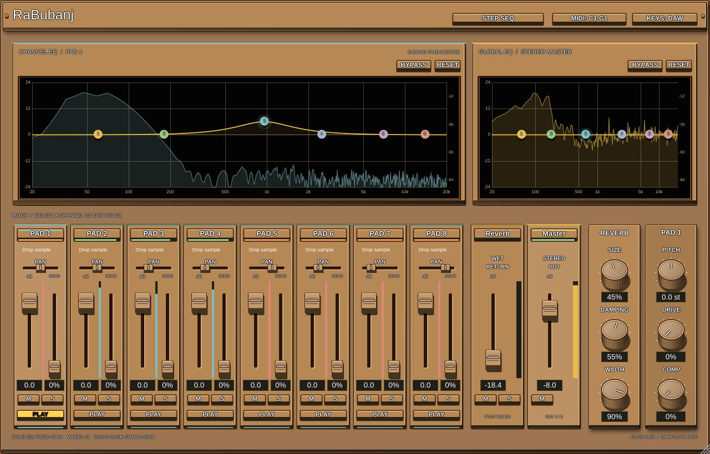
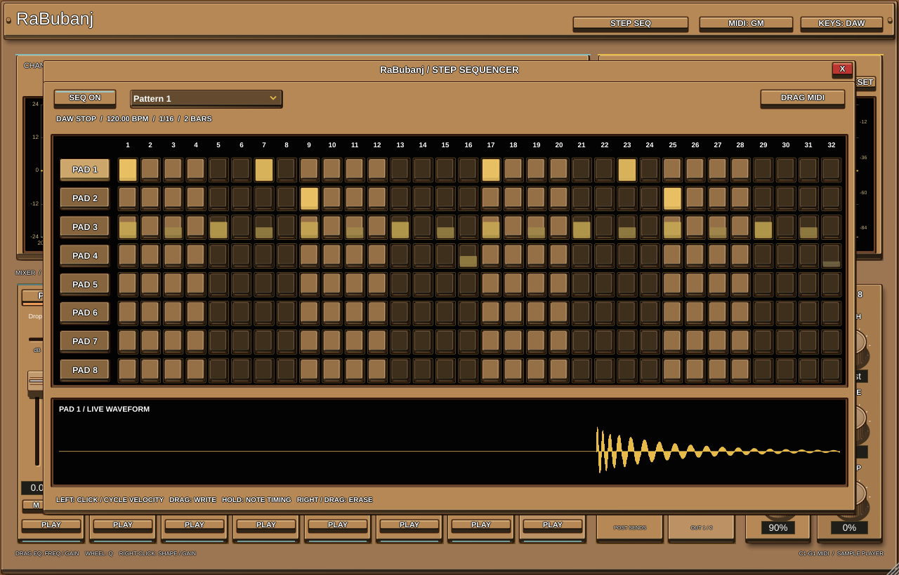

# Wood relief — work in progress

The original user-supplied wood image is still required as a downloadable file.
These previews show solid-colour relief only; no substitute texture has been used.
This branch is not a new Windows release. Stable main remains RaBubanj 0.10.0.

## Implemented

- Much taller round controls, cylindrical sides, deep shadows, cut rim grooves and incised position marks.
- Raised wooden-form fader caps and pan/timing slider handles. Travel padding accommodates their height.
- Deeper panel sides, EQ frames and recessed display wells; wooden-form header plugs and raised EQ nodes.
- Individual raised step keys and PAD labels, with existing velocity, timing and selection markers.
- Carved button and dropdown styling, white outlined legends, red close controls and yellow PLAY feedback.
- A cached GUI-only image resource hook. CMake embeds `Assets/wood-reference.png`, `.jpg` or `.jpeg` unchanged when provided. The texture is drawn at uniform scale/crop with separate relief lighting.

## Verification — 20 November 2026

Linux Release VST3/standalone build passed. Existing mixer/editor and sequencer integration suites passed, followed by preview-export runs of both suites after the last visual change. Rendered minimum/default previews were inspected; default/maximum exports were also produced. Signal processing, parameter IDs and state formats were not changed.

The image-present resource path and final textured appearance remain pending the original asset. Windows CI and a new portable package will follow the completed texture integration. No completed wood-theme release is claimed here.
