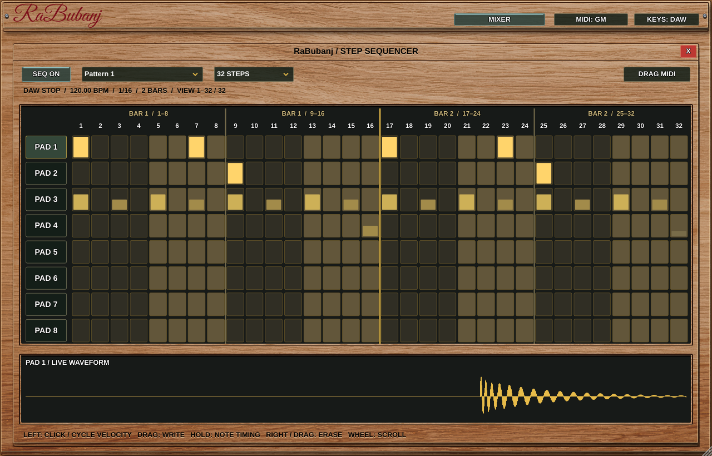

# Wood panels and metal controls

The housing, channel sections, EQ frames and sequencer enclosure use the original user-supplied JPEG. See [asset provenance and checksum](../Assets/README.md). The source image is not edited, recoloured or regenerated; its natural grain is drawn at uniform scale and cropped as needed. A 48% matte red-brown finish is composited at paint time, calming the grain contrast while preserving the warmer reddish tone. Bevel lighting and shadows are drawn separately.

Round controls follow the supplied knob reference: tall metal cylinders with broad vertical flutes, black bases, thin scalloped silver lips and matte coloured top discs. Thick radial bars reach the rim; the off-white cap has a black bar and the other caps have white bars. Colours: SIZE teal, DAMPING off-white, WIDTH burgundy, PITCH blue, DRIVE red and COMP purple. Fader caps follow the console reference with a concave saddle, raised wings, dark end cheeks, brushed aluminium centre and white index line. The same profile is scaled/rotated for SEND, PAN and TIMING handles. EQ nodes and screws retain metal surfaces. Cool directional highlights and fine brushing distinguish them from the wood.

Rotary artwork is 15% larger than in 0.12: 80.5% of the original reference-model size. Slot bounds, mouse interaction and automation remain. Large command legends remain bold and readable on dark contrast plates.

Raised text buttons and selector housings are replaced by flat caption plates throughout the mixer, EQ panels, header and sequencer. Click actions, state feedback, channel meters, yellow PLAY illumination and red close controls remain.

Step cells return to plain flat rectangles, starting with four dark steps and alternating with four light steps. Filled velocity bars, selected-pad highlights, playhead outlines and timing markers remain distinct. The flat caption and step renderers contain no metal surface fill, bevel, raised sidewall or cast shadow.

Printed wood captions use larger bold black lettering with a subtle pale lower edge. Normal sample names and placeholders are 12 px black; load errors use dark red. Screen/flat-control text stays light for contrast. The bottom-right C1-G1/sample-player footer is removed.

The dark-red RaBubanj wordmark uses embedded Great Vibes lettering inspired by the supplied calligraphic reference. Glyph outlines are cached and fitted by their actual ink bounds, preserving swashes without clipping. The font and its SIL OFL license are bundled; no host-installed font is needed.

The sequencer is a dedicated page below the shared header. Mixer controls and EQ panels are hidden until MIXER or the red X returns to the mixer; no cut-off mixer edges remain. The page fills the working area at all supported sizes and cannot be dragged over other controls. Its title, transport status, timing popup captions and footer use larger bold black print on wood. Dark screens keep light text.

The grid has labelled eight-step groups and a stronger divider between steps 16 and 17. Four-dark/four-light cells remain. Grid, waveform and EQ interiors use an opaque solid dark screen material; original wood remains on their carved frames.

Long patterns retain the same 32-column on-screen cell size. PAD labels stay fixed while the grid scrolls horizontally by wheel or scrollbar. The length choice and VIEW range appear above the grid. Group headings/bar separators continue to step 128.
