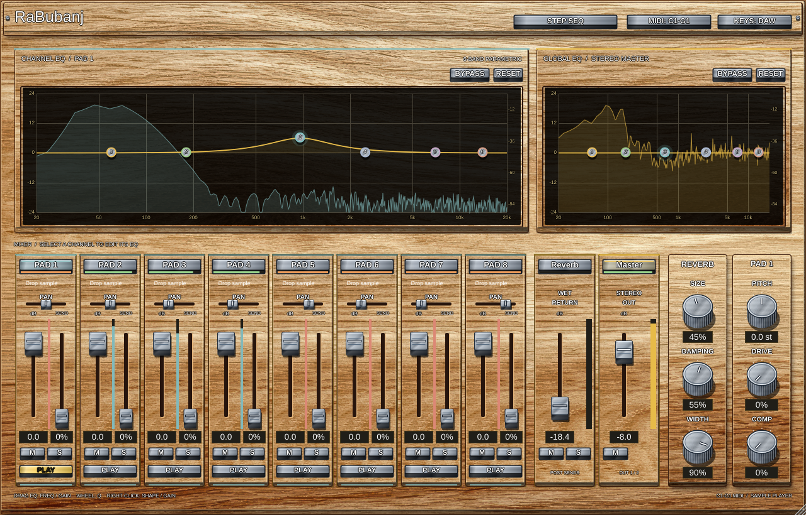

# Wood panels and metal controls

The housing, channel sections, EQ frames and sequencer enclosure use the original user-supplied JPEG. See [asset provenance and checksum](../Assets/README.md). The source image is not edited, recoloured or regenerated; its natural grain is drawn at uniform scale and cropped as needed. Bevel lighting and shadows are drawn separately.

Round controls have high metal cylinders, knurled sidewalls, concentric machining marks and incised position indicators. Pushbuttons, fader/PAN/TIMING handles, dropdown housings, PAD labels, sequencer keys, EQ nodes and screws also use metal surfaces. Cool directional highlights and fine brushing distinguish them from the wood.

White outlined legends, yellow PLAY feedback, red close buttons, channel meters and velocity/timing markers retain their functions. The visual change does not alter processing, MIDI mapping, patterns, sample recall or parameter IDs.

